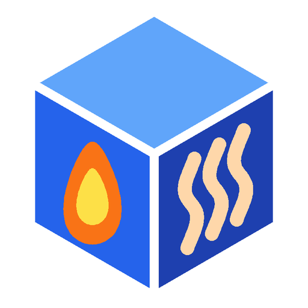

# MAX! Cube Evolution

Home-Assistant-Integration für das **eQ-3 MAX! Cube LAN Gateway** mit Heizkörperthermostaten, Wandthermostaten und Fensterkontakten. Sie ist der Nachfolger der Core-Integration `maxcube`: komplett über die Oberfläche einrichtbar, mit **Thermostat-Parametern, Boost-Telegramm, Cube-Diagnose** und einer **Taste zum Übernehmen der alten Core-Entitäten**.

## Funktionen

- **Thermostate** als Klima-Entitäten: Automatik, Manuell, Aus, Boost, Komfort, Eco, Urlaub
- **Echter MAX!-Boost**: Es wird das Boost-Telegramm gesendet, keine Ersatz-Temperatur
- **Ventilöffnung** je Heizkörperthermostat als Sensor
- **Fensterkontakte** und **Batteriestatus** als Binärsensoren
- **Parameter der Heizkörperthermostate** einstellbar: Komfort-, Eco-, Min-/Max-Temperatur, Offset, Fenster-offen-Temperatur und -Dauer, Boost-Dauer und -Ventilöffnung, maximale Ventilöffnung, Ventil-Offset
- **Cube-Diagnose**: Funkauslastung (Duty Cycle), freie Speicherplätze, Befehlsfehler
- **Automatische Suche** des Cubes im Netzwerk. Ein über die Suche eingerichteter Cube wird nach einem IP-Wechsel (DHCP) wiedergefunden.
- **Dienste** zum Neuverbinden und Neustarten des Cubes
- **Übernahme aus der Core-Integration**: Entitäts-IDs, Automationen, Dashboards und Verlauf bleiben erhalten

Das Funkprotokoll für Parameter und Boost stammt aus [MAX! Home Automation](http://www.dmitry-kazakov.de/ada/max_home_automation.htm) von Dmitry A. Kazakov und wurde Byte für Byte damit abgeglichen.

## Voraussetzungen

- Home Assistant **2024.12** oder neuer
- Ab **2026.3** wird das Integrations-Icon lokal angezeigt (Ordner `brand/`)
- Ein MAX! Cube im selben Netzwerk, TCP-Port **62910** und UDP-Port **23272** (Suche) erreichbar
- Der Cube erlaubt nur wenige gleichzeitige Verbindungen. Die MAX!-Software, MAX! Home Automation oder die Core-Integration `maxcube` sollten nicht gleichzeitig laufen.

## Installation

### Über HACS (empfohlen)

1. HACS öffnen → oben rechts **⋮** → **Benutzerdefinierte Repositories**
2. Repository: `https://github.com/Darkwulf183/maxcube-evolution`, Typ: **Integration** → **Hinzufügen**
3. Nach **MAX! Cube Evolution** suchen → **Herunterladen**
4. Home Assistant **neu starten**

### Manuell

1. Den Ordner `custom_components/maxcube_evolution` aus dem [neuesten Release](https://github.com/Darkwulf183/maxcube-evolution/releases) nach `/config/custom_components/` kopieren
2. Home Assistant **neu starten**

## Einrichtung

1. **Einstellungen → Geräte & Dienste → Integration hinzufügen → MAX! Cube Evolution**

   

2. Den gefundenen Cube auswählen oder **IP-Adresse manuell eingeben** (Port Standard: `62910`)
3. Optional unter **Konfigurieren**: Abfrageintervall in Sekunden (30–600, Standard 60)

### Thermostat-Parameter ändern

Die Parameter-Entitäten eines Heizkörperthermostats sind zuerst „nicht verfügbar“. Das ist Absicht, damit nichts Ungeprüftes geschrieben wird.

1. Am Thermostat-Gerät **Konfiguration laden** drücken
2. Danach den gewünschten Wert ändern. Die Integration liest die aktuelle Konfiguration vor dem Schreiben frisch ein, damit nichts anderes überschrieben wird, und liest sie danach zur Kontrolle noch einmal.

Jeder geänderte Wert ist ein Funkbefehl und zählt zur Funkauslastung des Cubes.

## Umstieg von der Core-Integration `maxcube`

Die Core-Integration wird per YAML eingerichtet. Ihre Entitäten bleiben nach dem Entfernen als verwaiste Einträge stehen und blockieren die Entitäts-IDs. MAX! Cube Evolution kann sie übernehmen.

1. Den Abschnitt `maxcube:` aus der `configuration.yaml` entfernen
2. Home Assistant **neu starten**
3. MAX! Cube Evolution installieren und einrichten (siehe oben). Die neuen Entitäten heißen zunächst z. B. `climate.bad_thermostat_2`.
4. Am Gerät **MAX! Cube** die Taste **Entitäten aus Core-Integration übernehmen** drücken

Danach heißen die Entitäten wieder wie vorher, z. B. `climate.bad_thermostat`. Automationen, Dashboards und der Verlauf funktionieren weiter. Name, Symbol, Bereich, Aliase, Labels, Kategorien und „ausgeblendet“ der alten Entität werden übernommen. Eine Benachrichtigung zeigt, was übernommen und was übersprungen wurde.

Übernommen werden Klima-Entitäten, Fensterkontakte und Batteriesensoren. Die Taste ändert nur die Entitäts-Registry von Home Assistant und sendet nichts an den Cube. Mehrmals drücken schadet nicht. Ein Backup vorher ist trotzdem empfehlenswert.

## Dienste

| Dienst | Wirkung |
|---|---|
| `maxcube_evolution.reconnect` | Trennt die TCP-Verbindung und aktualisiert den Cube |
| `maxcube_evolution.reboot` | Startet den Cube per UDP neu (kein Werksreset) |

Beide Dienste haben das optionale Feld `entry_id`. Ohne Angabe gilt der Dienst für alle eingerichteten Cubes.

## Funkauslastung (Duty Cycle)

Der Cube darf nur begrenzt funken. Erreicht die Funkauslastung **100 %**, sendet er etwa eine Stunde lang nichts mehr. Die Integration fragt den Cube nur über das Netzwerk ab und sendet Funkbefehle nur, wenn du etwas änderst. Den Sensor **Funkauslastung** im Blick behalten, besonders beim Ändern vieler Parameter.

## Fehlerbehebung

- **Cube wird nicht gefunden:** UDP-Port 23272 muss erreichbar sein, Home Assistant und Cube im selben Netz. Sonst **IP-Adresse manuell eingeben**.
- **„Keine Verbindung zum Cube möglich“:** Läuft noch die MAX!-Software, MAX! Home Automation oder die Core-Integration `maxcube`? Diese beenden.
- **Parameter „nicht verfügbar“:** Zuerst **Konfiguration laden** drücken.
- **„Die Core-Integration maxcube ist noch aktiv“:** `maxcube:` aus der `configuration.yaml` entfernen und neu starten.
- **„Cube reported a command error“:** Meist ist die Funkauslastung zu hoch. Etwas warten und erneut versuchen.
- Weitere Details stehen im Protokoll unter **Einstellungen → System → Protokolle**, Suchbegriffe `maxcube_evolution` und `maxcube`.

## Deinstallieren

1. Integration unter **Geräte & Dienste** löschen
2. Über HACS entfernen oder den Ordner löschen, dann neu starten

## Mitwirkende

| | Rolle |
|---|---|
| [@Darkwulf183](https://github.com/Darkwulf183) | Idee, Entwicklung, Tests, Maintainer |
| [Dmitry A. Kazakov](http://www.dmitry-kazakov.de/ada/max_home_automation.htm) | MAX!-Protokoll aus *MAX! Home Automation* (GPL), Grundlage für Parameter und Boost |
| [ChatGPT](https://chatgpt.com) (OpenAI) | Entwicklung der Integration |
| [Claude](https://claude.ai) (Anthropic) | Code-Review, Fehlerbehebung, Migrationstaste, Icon, Repository-Einrichtung |

## Lizenz

[GPL-2.0-or-later](LICENSE). Die Kodierung der Thermostat-Parameter ist eine Python-Umsetzung aus *MAX! Home Automation* von Dmitry A. Kazakov (GPL-2.0-or-later).

eQ-3 und MAX! sind Marken der eQ-3 AG. Dieses Projekt steht in keiner Verbindung zu eQ-3.
